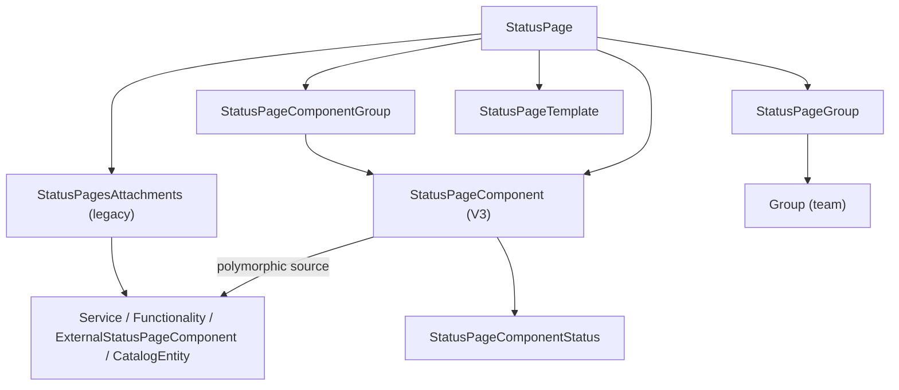
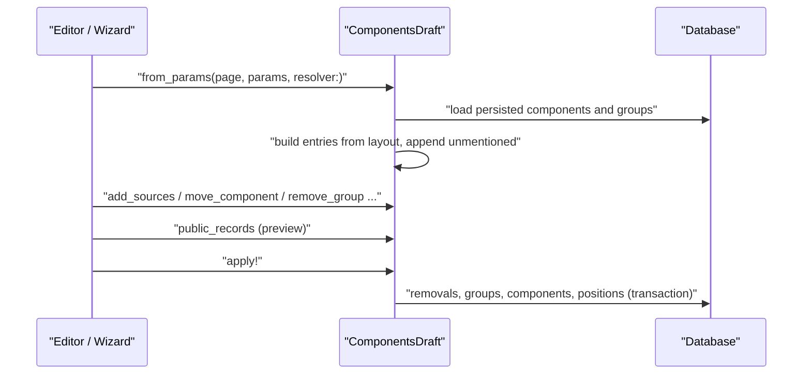

# Status pages

_Generated from rootlyhq/rootly at `0c14facc06a3` on 2026-11-04. A page goes stale when the files it cites change._

## Purpose

Status pages let a team publish incident and maintenance updates. A page can be public, which renders on a Rootly or custom domain, or private and internal. The `StatusPage` model owns the page. It has a list of **components** (V3, `StatusPageComponent`) that can be arranged in **component groups**. **Templates** (`StatusPageTemplate`) pre-fill incident updates. **Team access** (`StatusPageGroup`) grants page-scoped permissions. **Subscribers** receive email or SMS, and SMS verification is rate-limited by `SmsVerificationThrottle`. **Uptime metrics** come from the `HasUptimeMetrics` concern. The V3 editor and the setup wizard collect unsaved edits in two "draft" objects, `StatusPages::ComponentsDraft` and `StatusPages::TemplatesDraft`, and persist them in one transaction.

Most V3 behaviour is gated on the `status-page-v3-phase-1` feature flag. Examples are the [index view](https://github.com/rootlyhq/rootly/blob/0c14facc06a31b3be03f8799c2b33d61dd1d32d6/app/controllers/account/status_pages_controller.rb#L34-L55), [team access](https://github.com/rootlyhq/rootly/blob/0c14facc06a31b3be03f8799c2b33d61dd1d32d6/app/models/status_page_group.rb#L27-L29), [global templates](https://github.com/rootlyhq/rootly/blob/0c14facc06a31b3be03f8799c2b33d61dd1d32d6/app/models/status_page_template.rb#L64-L66) and [ad-hoc name checks](https://github.com/rootlyhq/rootly/blob/0c14facc06a31b3be03f8799c2b33d61dd1d32d6/app/models/status_page_component.rb#L201-L208).

## Data model

### `StatusPage`

`StatusPage` belongs to a team and is limited by the plan (`limited_by_plan :status_page_limit`). Much of its behaviour lives in concerns: publication, page type, subscriptions, custom domain validation and Searchkick indexing ([concerns](https://github.com/rootlyhq/rootly/blob/0c14facc06a31b3be03f8799c2b33d61dd1d32d6/app/models/status_page.rb#L10-L20)). It also carries transient `attr_accessor`s, including `components_draft` and `templates_draft`, which hold unsaved edits while a preview renders ([accessors](https://github.com/rootlyhq/rootly/blob/0c14facc06a31b3be03f8799c2b33d61dd1d32d6/app/models/status_page.rb#L7-L8)).

**Associations**
- **Legacy component store.** `services` and `functionalities` go through `attachments` (`StatusPagesAttachments`), and `external_components` goes through `status_pages_external_status_page_components`. Each of these has an `after_remove: :remove_status_page_component_for` hook ([associations](https://github.com/rootlyhq/rootly/blob/0c14facc06a31b3be03f8799c2b33d61dd1d32d6/app/models/status_page.rb#L32-L57)).
- **V3 store.** `status_page_components` and `status_page_component_groups` are both ordered by `position` ([V3 associations](https://github.com/rootlyhq/rootly/blob/0c14facc06a31b3be03f8799c2b33d61dd1d32d6/app/models/status_page.rb#L59-L61)).
- **Team access.** `status_page_groups` and `groups` accept nested attributes ([team access](https://github.com/rootlyhq/rootly/blob/0c14facc06a31b3be03f8799c2b33d61dd1d32d6/app/models/status_page.rb#L63-L66)).

**Constants**
- `UPTIME_LAST_DAYS_OPTIONS = [30, 60, 90]` and the image validations are defined in [the constants block](https://github.com/rootlyhq/rootly/blob/0c14facc06a31b3be03f8799c2b33d61dd1d32d6/app/models/status_page.rb#L293-L294).
- `DEFAULT_SECTION_ORDER` and `AVAILABLE_SECTIONS` are defined in [the section constants](https://github.com/rootlyhq/rootly/blob/0c14facc06a31b3be03f8799c2b33d61dd1d32d6/app/models/status_page.rb#L301-L302). They come from the section-ordering plan described below.

**Helpers**
- `effective_time_zone` falls back from the page's time zone to the team's, then to UTC. `current_date` uses it (time zone).
- `incident_history` wraps `StatusPage::IncidentHistoryWindow` ([history](https://github.com/rootlyhq/rootly/blob/0c14facc06a31b3be03f8799c2b33d61dd1d32d6/app/models/status_page.rb#L516-L518)).
- `authentication_enabled?` returns true when the page uses a password or SAML ([auth](https://github.com/rootlyhq/rootly/blob/0c14facc06a31b3be03f8799c2b33d61dd1d32d6/app/models/status_page.rb#L342-L344)).
- `smart_display_name` appends "(Statuspage.io)" and "(Public)" or "(Private)" to the title ([display name](https://github.com/rootlyhq/rootly/blob/0c14facc06a31b3be03f8799c2b33d61dd1d32d6/app/models/status_page.rb#L753-L759)).

**Custom domains**
- `find_by_custom_domain` looks up enabled public pages by host. It checks Cloudflare mappings first when the request came through Cloudflare ([lookup](https://github.com/rootlyhq/rootly/blob/0c14facc06a31b3be03f8799c2b33d61dd1d32d6/app/models/status_page.rb#L255-L263)).
- Cloudflare mappings are stored in the `cloudflare_domain_names` JSONB column. They are changed with atomic `update_all` JSONB operators (add/remove) and read back as CNAME records ([cname_records](https://github.com/rootlyhq/rootly/blob/0c14facc06a31b3be03f8799c2b33d61dd1d32d6/app/models/status_page.rb#L280-L291)).

### `StatusPageComponent`

A component row is either **ad-hoc** (`source_id` is nil) or **catalog-based** (it has a polymorphic `source`) ([source](https://github.com/rootlyhq/rootly/blob/0c14facc06a31b3be03f8799c2b33d61dd1d32d6/app/models/status_page_component.rb#L8-L11), ad_hoc?/catalog_based?).

**Associations and options**
- Its statuses (`StatusPageComponentStatus`) are ordered newest first, and `current_status` is `statuses.first` ([statuses](https://github.com/rootlyhq/rootly/blob/0c14facc06a31b3be03f8799c2b33d61dd1d32d6/app/models/status_page_component.rb#L13-L17), [current_status](https://github.com/rootlyhq/rootly/blob/0c14facc06a31b3be03f8799c2b33d61dd1d32d6/app/models/status_page_component.rb#L177-L179)).
- It uses `has_paper_trail`.
- `acts_as_list` is scoped to the page and the group ([list](https://github.com/rootlyhq/rootly/blob/0c14facc06a31b3be03f8799c2b33d61dd1d32d6/app/models/status_page_component.rb#L34)).

**Validations**
- `source_id` must be unique per page and source type.
- The component's group must belong to the same page.
- An ad-hoc name must not already be taken in the "ad-hoc component catalog". Importers are exempt from this check ([validations](https://github.com/rootlyhq/rootly/blob/0c14facc06a31b3be03f8799c2b33d61dd1d32d6/app/models/status_page_component.rb#L19-L32)).

**Callbacks**
- `before_create :create_ad_hoc_catalog_entity` backs a new ad-hoc component with a `CatalogEntity` from `StatusPages::AdHocComponentCatalog.entity_for!`. It skips this when the page already shows a duplicate ad-hoc name, or when that entity is already attached to the page (create).
- `catalog_type_ad_hoc_component?` identifies these backed components ([check](https://github.com/rootlyhq/rootly/blob/0c14facc06a31b3be03f8799c2b33d61dd1d32d6/app/models/status_page_component.rb#L133-L137)).
- `after_update` writes name and description changes back to the entity. Set `skip_catalog_entity_sync_on_update` to opt out ([sync](https://github.com/rootlyhq/rootly/blob/0c14facc06a31b3be03f8799c2b33d61dd1d32d6/app/models/status_page_component.rb#L231-L238)).
- `after_create` and `after_destroy` open and close a `StatusPageComponentTrackingInterval` for catalog-based components. The interval records when a source was on the page, and the record survives a hard delete of the row ([tracking](https://github.com/rootlyhq/rootly/blob/0c14facc06a31b3be03f8799c2b33d61dd1d32d6/app/models/status_page_component.rb#L43-L53)).

**Display helpers**
- `display_name` and `public_display_name` use the component's `name` first and fall back to the source's name (names).
- `display_description` follows the same pattern for descriptions ([description](https://github.com/rootlyhq/rootly/blob/0c14facc06a31b3be03f8799c2b33d61dd1d32d6/app/models/status_page_component.rb#L171-L175)).

**Event selection**
- `event_record_pair` and `event_selection_key` identify a component when an incident event selects it. Ad-hoc components use `["StatusPageComponent", id]` and catalog-based components use `[source_type, source_id]` (keys).
- The `event_selectable` scope excludes components whose source is an `ExternalStatusPageComponent` ([scopes](https://github.com/rootlyhq/rootly/blob/0c14facc06a31b3be03f8799c2b33d61dd1d32d6/app/models/status_page_component.rb#L55-L71)).

### Keeping the legacy and V3 stores in sync

The rule is: *a catalog-based component exists if and only if a live attachment exists* ([comment](https://github.com/rootlyhq/rootly/blob/0c14facc06a31b3be03f8799c2b33d61dd1d32d6/app/models/status_page_component.rb#L73-L77)).

- **`StatusPageComponent.ensure_for`** creates the component if it does not exist. It then calls `place_component_in_components_tab_order!` so the new component matches the order of the legacy Components tab. If it loses a create race, it swallows the uniqueness error ([ensure_for](https://github.com/rootlyhq/rootly/blob/0c14facc06a31b3be03f8799c2b33d61dd1d32d6/app/models/status_page_component.rb#L78-L89)).
- **`remove_for`** destroys the component that mirrors a removed source ([remove_for](https://github.com/rootlyhq/rootly/blob/0c14facc06a31b3be03f8799c2b33d61dd1d32d6/app/models/status_page_component.rb#L91-L93)).
- **`StatusPage#attach_component_source!`** attaches a source to the page. Services and functionalities go through `attachments`, and external components go through their join table, so the mirror hooks create the component. Any other source type creates the component directly. The method is idempotent and can optionally assign a group ([attach](https://github.com/rootlyhq/rootly/blob/0c14facc06a31b3be03f8799c2b33d61dd1d32d6/app/models/status_page.rb#L81-L99)).
- **`StatusPageComponent#detach!`** works in the opposite direction. It deletes the legacy join rows if they exist, otherwise it destroys the component itself ([detach!](https://github.com/rootlyhq/rootly/blob/0c14facc06a31b3be03f8799c2b33d61dd1d32d6/app/models/status_page_component.rb#L101-L115)).

### Top-level ordering

Groups and ungrouped components share one top-level `position` sequence.

- `top_level_entries` merges the groups and the ungrouped components, then sorts them by `[position, created_at, id]` ([entries](https://github.com/rootlyhq/rootly/blob/0c14facc06a31b3be03f8799c2b33d61dd1d32d6/app/models/status_page.rb#L119-L123)).
- `components_in_layout_order` flattens groups into their member components ([flatten](https://github.com/rootlyhq/rootly/blob/0c14facc06a31b3be03f8799c2b33d61dd1d32d6/app/models/status_page.rb#L127-L131)).
- `place_top_level_entry!` re-sequences the entries using `update_column`, so validations and callbacks do not run ([place](https://github.com/rootlyhq/rootly/blob/0c14facc06a31b3be03f8799c2b33d61dd1d32d6/app/models/status_page.rb#L139-L149)).
- `with_top_level_order_preserved` takes a snapshot of the order, yields, and calls `resequence_top_level!`. Survivors keep their previous order and new entries are appended by `created_at` (preserve).

### `StatusPageGroup`

`StatusPageGroup` assigns a team (`Group`) to a page. Its `permission_level` enum has two values ([model](https://github.com/rootlyhq/rootly/blob/0c14facc06a31b3be03f8799c2b33d61dd1d32d6/app/models/status_page_group.rb#L1-L34)):
- `publish_only` covers status updates and announcements.
- `edit_and_publish` also covers editing the page and its content.

The `group_in_same_team` validation stops groups from another tenant from being attached ([validation](https://github.com/rootlyhq/rootly/blob/0c14facc06a31b3be03f8799c2b33d61dd1d32d6/app/models/status_page_group.rb#L51-L56)). Per the class comment, the uniqueness check and the `MAX_GROUPS_PER_PAGE = 50` cap are validated on `StatusPage`, across the whole nested collection.

### `StatusPageTemplate`

A template has one of two scopes:
- **Page-scoped:** `status_page_id` is set.
- **Global:** `team_id` is set and `status_page_id` is nil.

The validations make these mutually exclusive. Global templates have a cap of `MAX_GLOBAL_TEMPLATES_PER_TEAM = 100` and their own length limits ([validations](https://github.com/rootlyhq/rootly/blob/0c14facc06a31b3be03f8799c2b33d61dd1d32d6/app/models/status_page_template.rb#L38-L46), [limit](https://github.com/rootlyhq/rootly/blob/0c14facc06a31b3be03f8799c2b33d61dd1d32d6/app/models/status_page_template.rb#L117-L121)).

**Behaviour**
- `kind` is either `normal` or `scheduled`.
- `status_lifecycle_order` sorts templates by `UPDATE_STATUS_LIFECYCLE_ORDER` ([enum/scopes](https://github.com/rootlyhq/rootly/blob/0c14facc06a31b3be03f8799c2b33d61dd1d32d6/app/models/status_page_template.rb#L6-L35)).
- `offered_for(team:, status_pages:)` adds enabled global templates only when `global_templates_enabled?` is true. That requires both the `status-page-v3-phase-1` and `status-page-global-templates` flags ([offered_for](https://github.com/rootlyhq/rootly/blob/0c14facc06a31b3be03f8799c2b33d61dd1d32d6/app/models/status_page_template.rb#L64-L73)).
- Allowed update statuses come from `IncidentStatusPageEvent.status_options`. When the `enable_sync_services_from_service_now` Flipper flag is on, page templates also get `SERVICE_NOW_UPDATE_STATUSES` ([statuses](https://github.com/rootlyhq/rootly/blob/0c14facc06a31b3be03f8799c2b33d61dd1d32d6/app/models/status_page_template.rb#L79-L87), [allowed](https://github.com/rootlyhq/rootly/blob/0c14facc06a31b3be03f8799c2b33d61dd1d32d6/app/models/status_page_template.rb#L130-L145)).
- `smart_body` and `smart_update_title` render Liquid against an incident ([liquid](https://github.com/rootlyhq/rootly/blob/0c14facc06a31b3be03f8799c2b33d61dd1d32d6/app/models/status_page_template.rb#L106-L113)).
- For Statuspage.io-linked templates, `title` is delegated to `StatusPageIo::TemplatesPresenter` ([title](https://github.com/rootlyhq/rootly/blob/0c14facc06a31b3be03f8799c2b33d61dd1d32d6/app/models/status_page_template.rb#L94-L104)).
- Templates are soft-deleted with `acts_as_paranoid`, and `acts_as_list` is scoped to `deleted_at: nil` ([list](https://github.com/rootlyhq/rootly/blob/0c14facc06a31b3be03f8799c2b33d61dd1d32d6/app/models/status_page_template.rb#L58-L62)).

## Drafts: editing without saving

The V3 editor and the wizard edit components and templates in memory. Previews render from that in-memory state (`public_records`). `apply!` then writes everything in one transaction.

### `StatusPages::ComponentsDraft`

The draft holds a list of `ComponentEntry` and `GroupEntry` structs. Each entry has a `key` and a `record`, and a `GroupEntry` also has `members` ([structs](https://github.com/rootlyhq/rootly/blob/0c14facc06a31b3be03f8799c2b33d61dd1d32d6/app/models/status_pages/components_draft.rb#L1-L16)). Persisted rows use their id as the key. New rows get `"new-" + hex` from `generate_key` ([keys](https://github.com/rootlyhq/rootly/blob/0c14facc06a31b3be03f8799c2b33d61dd1d32d6/app/models/status_pages/components_draft.rb#L181-L183)).

**Building a draft**
- `baseline(page)` loads `top_level_entries` ([load_baseline](https://github.com/rootlyhq/rootly/blob/0c14facc06a31b3be03f8799c2b33d61dd1d32d6/app/models/status_pages/components_draft.rb#L209-L220)).
- `from_params` permits `layout`, `groups`, `components` and `removed` ([from_params](https://github.com/rootlyhq/rootly/blob/0c14facc06a31b3be03f8799c2b33d61dd1d32d6/app/models/status_pages/components_draft.rb#L23-L29)).
- `load_params` walks `layout` keys of the form `"group:<key>"` and `"component:<key>"`. It marks removed keys and appends persisted records the params did not mention, so a partial payload never drops rows ([load_params](https://github.com/rootlyhq/rootly/blob/0c14facc06a31b3be03f8799c2b33d61dd1d32d6/app/models/status_pages/components_draft.rb#L222-L253), [append_unmentioned](https://github.com/rootlyhq/rootly/blob/0c14facc06a31b3be03f8799c2b33d61dd1d32d6/app/models/status_pages/components_draft.rb#L306-L328)).
- A new component is built in one of two ways ([build_new_component_entry](https://github.com/rootlyhq/rootly/blob/0c14facc06a31b3be03f8799c2b33d61dd1d32d6/app/models/status_pages/components_draft.rb#L294-L304)):
  - from a `source_key`, through the injected `resolver` (the wizard passes `StatusPages::ComponentSourceResolver`), or
  - as an ad-hoc component from a `name`.

**Mutations**

Every mutation sets `dirty?`:
- `add_sources` skips sources that are already in the draft ([add_sources](https://github.com/rootlyhq/rootly/blob/0c14facc06a31b3be03f8799c2b33d61dd1d32d6/app/models/status_pages/components_draft.rb#L79-L93)).
- `add_component` and `add_group` add new entries.
- `move_component` and `update_group_members` change group membership.
- `remove_component` and `remove_group` remove entries. Removing a group also queues its persisted members for removal ([remove_group](https://github.com/rootlyhq/rootly/blob/0c14facc06a31b3be03f8799c2b33d61dd1d32d6/app/models/status_pages/components_draft.rb#L144-L152)).

**Preview and persistence**
- `public_records` pre-loads each group's `status_page_components` association with the draft's members, so preview components can render without queries ([public_records](https://github.com/rootlyhq/rootly/blob/0c14facc06a31b3be03f8799c2b33d61dd1d32d6/app/models/status_pages/components_draft.rb#L154-L164)).
- `apply!` runs removals, then groups, then components, then positions ([apply!](https://github.com/rootlyhq/rootly/blob/0c14facc06a31b3be03f8799c2b33d61dd1d32d6/app/models/status_pages/components_draft.rb#L166-L173)). Removed components go through `detach!`, which keeps the legacy store in sync ([apply_removals!](https://github.com/rootlyhq/rootly/blob/0c14facc06a31b3be03f8799c2b33d61dd1d32d6/app/models/status_pages/components_draft.rb#L330-L334)).

### `StatusPages::TemplatesDraft`

`TemplatesDraft` uses the same pattern for templates.

- `entries` sorts by lifecycle status, then by title ([entries](https://github.com/rootlyhq/rootly/blob/0c14facc06a31b3be03f8799c2b33d61dd1d32d6/app/models/status_pages/templates_draft.rb#L38-L44)).
- `import(io_templates)` adds Statuspage.io templates that are not already present ([import](https://github.com/rootlyhq/rootly/blob/0c14facc06a31b3be03f8799c2b33d61dd1d32d6/app/models/status_pages/templates_draft.rb#L84-L95)).
- On Statuspage.io-linked templates, only `enabled` can be edited ([assign_attributes](https://github.com/rootlyhq/rootly/blob/0c14facc06a31b3be03f8799c2b33d61dd1d32d6/app/models/status_pages/templates_draft.rb#L165-L172)).
- `serialized_attributes` emits only changed or new state, for round-tripping through hidden form fields ([serialized](https://github.com/rootlyhq/rootly/blob/0c14facc06a31b3be03f8799c2b33d61dd1d32d6/app/models/status_pages/templates_draft.rb#L97-L105)).
- `apply!` destroys removed templates and saves new or changed ones in a single transaction ([apply!](https://github.com/rootlyhq/rootly/blob/0c14facc06a31b3be03f8799c2b33d61dd1d32d6/app/models/status_pages/templates_draft.rb#L107-L115)).

## Setup wizard

`Account::StatusPagesController` redirects `new` and `create` to the wizard ([before_action](https://github.com/rootlyhq/rootly/blob/0c14facc06a31b3be03f8799c2b33d61dd1d32d6/app/controllers/account/status_pages_controller.rb#L19)). `StatusPages::V3::SetupWizardPageComponent` renders each step for a `StatusPageSetupWizard` object.

**The page and its steps**
- It builds an unsaved page with `wizard.build_status_page(resolver:)` and copies form errors onto it ([status_page](https://github.com/rootlyhq/rootly/blob/0c14facc06a31b3be03f8799c2b33d61dd1d32d6/app/components/status_pages/v3/setup_wizard_page_component.rb#L35-L39)).
- The first step, `audience`, offers `internal`, `public` or `customer` (audience). The stepper then runs through the wizard's remaining steps, with `review` last (steps).
- Non-review steps `PATCH` to `account_status_page_setup_wizard_step_path`. The review step `POST`s to `..._complete_path` (form_url/method).
- Attributes edited on other steps travel as hidden fields ([hidden_page_fields](https://github.com/rootlyhq/rootly/blob/0c14facc06a31b3be03f8799c2b33d61dd1d32d6/app/components/status_pages/v3/setup_wizard_page_component.rb#L123-L133)).

**Review step**
- It lists blocking errors from `wizard.blocking_errors`, each mapped to the step that fixes it through `BLOCKING_STEPS` ([blocking](https://github.com/rootlyhq/rootly/blob/0c14facc06a31b3be03f8799c2b33d61dd1d32d6/app/components/status_pages/v3/setup_wizard_page_component.rb#L33-L47)).
- Summary rows are built by `general_rows`, `components_rows` (built from the components draft), `appearance_rows` and `advanced_rows` (team chips per permission level) (rows).

**Team access**

Team access controls appear only when `team_access_enabled?` is true and the ability allows `:manage_team_access` (can_manage). The controller has a matching check ([controller](https://github.com/rootlyhq/rootly/blob/0c14facc06a31b3be03f8799c2b33d61dd1d32d6/app/controllers/account/status_pages_controller.rb#L756-L759)).

## Controller

`Account::StatusPagesController` loads and authorizes `:status_page` through the team for a long list of member actions ([authorization](https://github.com/rootlyhq/rootly/blob/0c14facc06a31b3be03f8799c2b33d61dd1d32d6/app/controllers/account/status_pages_controller.rb#L11)).

- **`index`**: under V3, renders `index_v3` with subscriber counts and editor information ([index](https://github.com/rootlyhq/rootly/blob/0c14facc06a31b3be03f8799c2b33d61dd1d32d6/app/controllers/account/status_pages_controller.rb#L24-L57)).
- **`show` and `incident_history`**: render the V3 overview and history window ([show](https://github.com/rootlyhq/rootly/blob/0c14facc06a31b3be03f8799c2b33d61dd1d32d6/app/controllers/account/status_pages_controller.rb#L59-L81)).
- **`remove_incident`**: destroys the incident's status page events, after authorizing each one ([remove](https://github.com/rootlyhq/rootly/blob/0c14facc06a31b3be03f8799c2b33d61dd1d32d6/app/controllers/account/status_pages_controller.rb#L97-L106)).
- **`publish`**: delegates to `StatusPage#publish` ([publish](https://github.com/rootlyhq/rootly/blob/0c14facc06a31b3be03f8799c2b33d61dd1d32d6/app/controllers/account/status_pages_controller.rb#L204-L210)).
- **`preview`**: loads the draft page plus active and scheduled incidents ([preview](https://github.com/rootlyhq/rootly/blob/0c14facc06a31b3be03f8799c2b33d61dd1d32d6/app/controllers/account/status_pages_controller.rb#L229-L237)).
- **`history`**: the authenticated private page. It renders the `status_page` layout and can serve RSS/Atom ([history](https://github.com/rootlyhq/rootly/blob/0c14facc06a31b3be03f8799c2b33d61dd1d32d6/app/controllers/account/status_pages_controller.rb#L285-L316)).
- **`subscribers`**: separate email and SMS tabs, plus a CSV export capped at 1,000 rows ([subscribers](https://github.com/rootlyhq/rootly/blob/0c14facc06a31b3be03f8799c2b33d61dd1d32d6/app/controllers/account/status_pages_controller.rb#L318-L340)).
- **`status_page_io_components`**: enqueues a refresh of the Statuspage.io cache if it is stale, then serves the cached components ([io components](https://github.com/rootlyhq/rootly/blob/0c14facc06a31b3be03f8799c2b33d61dd1d32d6/app/controllers/account/status_pages_controller.rb#L620-L645)).

## SMS verification throttle

`StatusPageSubscriber::SmsVerificationThrottle.allow?(subscriber)` increments `Rails.cache` counters for two sets of buckets ([constants](https://github.com/rootlyhq/rootly/blob/0c14facc06a31b3be03f8799c2b33d61dd1d32d6/app/models/status_page_subscriber/sms_verification_throttle.rb#L5-L7), [buckets](https://github.com/rootlyhq/rootly/blob/0c14facc06a31b3be03f8799c2b33d61dd1d32d6/app/models/status_page_subscriber/sms_verification_throttle.rb#L52-L59)):
- **Per phone** (by `phone_bidx`): 1 per 10 minutes and 3 per 7 days.
- **Per status page**: 20 per hour and 100 per day.

If any bucket goes over its limit, the throttle rolls back the keys it already incremented, using `PhoneVerificationRateLimit::Reservation`, and denies the request ([allow?](https://github.com/rootlyhq/rootly/blob/0c14facc06a31b3be03f8799c2b33d61dd1d32d6/app/models/status_page_subscriber/sms_verification_throttle.rb#L17-L30)). If the cache is unavailable, it **fails closed** and logs an error. The one exception is `NullStore`, which allows the request ([cache_unavailable](https://github.com/rootlyhq/rootly/blob/0c14facc06a31b3be03f8799c2b33d61dd1d32d6/app/models/status_page_subscriber/sms_verification_throttle.rb#L40-L46)).

## Uptime metrics (`HasUptimeMetrics`)

The concern is mixed into resources that have `incidents` and `event_statuses`. Its callers include `StatusPage::ComponentStatusHistory` and services. It defines these statuses ([statuses](https://github.com/rootlyhq/rootly/blob/0c14facc06a31b3be03f8799c2b33d61dd1d32d6/app/models/concerns/has_uptime_metrics.rb#L5-L36)):
- `IMPACTED`: any incident attached to the resource.
- `OUTAGE`: a partial or major outage.
- `PARTIAL_OUTAGE`, `MAJOR_OUTAGE` and `MAINTENANCE`.

**`uptime_pct`**

`uptime_pct(since:, status:, ...)` sums the downtime seconds for `status` from `status_duration_metrics_by_period`. It then returns `calculate_sla` = `max(0, (period - downtime) / period * 100)` ([uptime_pct](https://github.com/rootlyhq/rootly/blob/0c14facc06a31b3be03f8799c2b33d61dd1d32d6/app/models/concerns/has_uptime_metrics.rb#L44-L49), [calculate_sla](https://github.com/rootlyhq/rootly/blob/0c14facc06a31b3be03f8799c2b33d61dd1d32d6/app/models/concerns/has_uptime_metrics.rb#L251-L253)). Callers can pass precomputed `metrics:` to avoid recomputing them.

**`status_duration_metrics_by_period`**

This method builds a hash keyed by period start ([metrics](https://github.com/rootlyhq/rootly/blob/0c14facc06a31b3be03f8799c2b33d61dd1d32d6/app/models/concerns/has_uptime_metrics.rb#L59-L102)):
1. It loads event statuses and incidents in scope, and maintenance inactive intervals from `IncidentStatusPageEvent.inactive_intervals_by_incident_id`.
2. For each status, it clips the incident ranges to the period.
3. It also folds partial and major outages into `OUTAGE`.
4. It treats a range where three or more partial outages intersect as a major outage.
5. It merges overlapping ranges, then computes seconds and a percentage.

**Incident scope**

`HasUptimeMetrics.incident_scope` keeps only incidents that can overlap the window ([scope](https://github.com/rootlyhq/rootly/blob/0c14facc06a31b3be03f8799c2b33d61dd1d32d6/app/models/concerns/has_uptime_metrics.rb#L122-L163)):
- **Non-scheduled incidents** use an end time taken from the first available of: the latest "mitigated" sub-status (on teams with sub-statuses), `mitigated_at`, `resolved_at` or `cancelled_at`.
- **Scheduled incidents** use `OVERLAPS` on `scheduled_for` and `scheduled_until`.
- **Excluded incidents**: the scope drops `excluded_incident_ids`, which are incidents where the resource was deselected as a component, so uptime matches the resource's badge.

`active_ranges` subtracts inactive intervals from a range ([active_ranges](https://github.com/rootlyhq/rootly/blob/0c14facc06a31b3be03f8799c2b33d61dd1d32d6/app/models/concerns/has_uptime_metrics.rb#L109-L120)).

## Section ordering plan (PRF-1396)

`docs/plans/PRF-1396-status-page-section-ordering.md` proposes the following ([plan](https://github.com/rootlyhq/rootly/blob/0c14facc06a31b3be03f8799c2b33d61dd1d32d6/docs/plans/PRF-1396-status-page-section-ordering.md#L17-L98)):
- a `section_order` JSONB column,
- validation against `AVAILABLE_SECTIONS`,
- an `ordered_sections` helper that appends missing sections at the end,
- rendering in the V2 `PageComponent` that follows this order.

The constants from the plan exist in the model ([constants](https://github.com/rootlyhq/rootly/blob/0c14facc06a31b3be03f8799c2b33d61dd1d32d6/app/models/status_page.rb#L301-L302)). The rest of the plan is not shown in the excerpts given here.

## Gotchas

- **Removing catalog sources.** Do not delete `StatusPageComponent` rows for catalog sources directly. Use `detach!` or the legacy collections, otherwise the two stores drift apart (IR-5786).
- **Re-sequencing bypasses callbacks.** Position re-sequencing uses `update_column`, so callbacks and validations do not run.
- **Template scope is exclusive.** A template with both `status_page_id` and `team_id` set is invalid.
- **Throttle fails closed.** Outside `NullStore`, an outage of `Rails.cache` blocks SMS verification.
- **External components in events.** `ExternalStatusPageComponent`-backed components are never event-selectable.

## Tests

Specs mentioned in the call graph:
- `spec/models/status_page_template_spec.rb`
- `spec/models/status_page_subscriber/sms_verification_throttle_spec.rb`
- `spec/models/concerns/has_uptime_metrics_spec.rb`
- `spec/models/status_page/component_status_history_spec.rb`
- `spec/components/status_pages/v3/page_component_spec.rb`
- `spec/requests/account/status_pages_edit_v3_spec.rb`
- `spec/requests/public/status_pages_spec.rb`
- `spec/requests/public/status_page_subscribers_spec.rb`

## Related pages

[[Statuspage.io import and external status pages]] · [[Incidents lifecycle]] · [[Service catalog and checklists]] · [[Authorization and abilities]] · [[Feature flags and configuration]] · [[Stakeholder communications]] · [[Public REST API]]

## Sources

- [app/components/status_pages/v3/setup_wizard_page_component.rb:33-47](https://github.com/rootlyhq/rootly/blob/0c14facc06a31b3be03f8799c2b33d61dd1d32d6/app/components/status_pages/v3/setup_wizard_page_component.rb#L33-L47)
- [app/components/status_pages/v3/setup_wizard_page_component.rb:123-133](https://github.com/rootlyhq/rootly/blob/0c14facc06a31b3be03f8799c2b33d61dd1d32d6/app/components/status_pages/v3/setup_wizard_page_component.rb#L123-L133)
- [app/controllers/account/status_pages_controller.rb:11-11](https://github.com/rootlyhq/rootly/blob/0c14facc06a31b3be03f8799c2b33d61dd1d32d6/app/controllers/account/status_pages_controller.rb#L11)
- [app/controllers/account/status_pages_controller.rb:19-19](https://github.com/rootlyhq/rootly/blob/0c14facc06a31b3be03f8799c2b33d61dd1d32d6/app/controllers/account/status_pages_controller.rb#L19)
- [app/controllers/account/status_pages_controller.rb:24-57](https://github.com/rootlyhq/rootly/blob/0c14facc06a31b3be03f8799c2b33d61dd1d32d6/app/controllers/account/status_pages_controller.rb#L24-L57)
- [app/controllers/account/status_pages_controller.rb:59-81](https://github.com/rootlyhq/rootly/blob/0c14facc06a31b3be03f8799c2b33d61dd1d32d6/app/controllers/account/status_pages_controller.rb#L59-L81)
- [app/controllers/account/status_pages_controller.rb:97-106](https://github.com/rootlyhq/rootly/blob/0c14facc06a31b3be03f8799c2b33d61dd1d32d6/app/controllers/account/status_pages_controller.rb#L97-L106)
- [app/controllers/account/status_pages_controller.rb:204-210](https://github.com/rootlyhq/rootly/blob/0c14facc06a31b3be03f8799c2b33d61dd1d32d6/app/controllers/account/status_pages_controller.rb#L204-L210)
- [app/controllers/account/status_pages_controller.rb:229-237](https://github.com/rootlyhq/rootly/blob/0c14facc06a31b3be03f8799c2b33d61dd1d32d6/app/controllers/account/status_pages_controller.rb#L229-L237)
- [app/controllers/account/status_pages_controller.rb:285-316](https://github.com/rootlyhq/rootly/blob/0c14facc06a31b3be03f8799c2b33d61dd1d32d6/app/controllers/account/status_pages_controller.rb#L285-L316)
- [app/controllers/account/status_pages_controller.rb:318-340](https://github.com/rootlyhq/rootly/blob/0c14facc06a31b3be03f8799c2b33d61dd1d32d6/app/controllers/account/status_pages_controller.rb#L318-L340)
- [app/controllers/account/status_pages_controller.rb:620-645](https://github.com/rootlyhq/rootly/blob/0c14facc06a31b3be03f8799c2b33d61dd1d32d6/app/controllers/account/status_pages_controller.rb#L620-L645)
- [app/controllers/account/status_pages_controller.rb:756-759](https://github.com/rootlyhq/rootly/blob/0c14facc06a31b3be03f8799c2b33d61dd1d32d6/app/controllers/account/status_pages_controller.rb#L756-L759)
- [app/models/concerns/has_uptime_metrics.rb:5-36](https://github.com/rootlyhq/rootly/blob/0c14facc06a31b3be03f8799c2b33d61dd1d32d6/app/models/concerns/has_uptime_metrics.rb#L5-L36)
- [app/models/concerns/has_uptime_metrics.rb:44-49](https://github.com/rootlyhq/rootly/blob/0c14facc06a31b3be03f8799c2b33d61dd1d32d6/app/models/concerns/has_uptime_metrics.rb#L44-L49)
- [app/models/concerns/has_uptime_metrics.rb:59-102](https://github.com/rootlyhq/rootly/blob/0c14facc06a31b3be03f8799c2b33d61dd1d32d6/app/models/concerns/has_uptime_metrics.rb#L59-L102)
- [app/models/concerns/has_uptime_metrics.rb:109-120](https://github.com/rootlyhq/rootly/blob/0c14facc06a31b3be03f8799c2b33d61dd1d32d6/app/models/concerns/has_uptime_metrics.rb#L109-L120)
- [app/models/concerns/has_uptime_metrics.rb:122-163](https://github.com/rootlyhq/rootly/blob/0c14facc06a31b3be03f8799c2b33d61dd1d32d6/app/models/concerns/has_uptime_metrics.rb#L122-L163)
- [app/models/concerns/has_uptime_metrics.rb:251-253](https://github.com/rootlyhq/rootly/blob/0c14facc06a31b3be03f8799c2b33d61dd1d32d6/app/models/concerns/has_uptime_metrics.rb#L251-L253)
- [app/models/status_page_component.rb:8-11](https://github.com/rootlyhq/rootly/blob/0c14facc06a31b3be03f8799c2b33d61dd1d32d6/app/models/status_page_component.rb#L8-L11)
- [app/models/status_page_component.rb:13-17](https://github.com/rootlyhq/rootly/blob/0c14facc06a31b3be03f8799c2b33d61dd1d32d6/app/models/status_page_component.rb#L13-L17)
- [app/models/status_page_component.rb:19-32](https://github.com/rootlyhq/rootly/blob/0c14facc06a31b3be03f8799c2b33d61dd1d32d6/app/models/status_page_component.rb#L19-L32)
- [app/models/status_page_component.rb:34-34](https://github.com/rootlyhq/rootly/blob/0c14facc06a31b3be03f8799c2b33d61dd1d32d6/app/models/status_page_component.rb#L34)
- [app/models/status_page_component.rb:43-53](https://github.com/rootlyhq/rootly/blob/0c14facc06a31b3be03f8799c2b33d61dd1d32d6/app/models/status_page_component.rb#L43-L53)
- [app/models/status_page_component.rb:55-71](https://github.com/rootlyhq/rootly/blob/0c14facc06a31b3be03f8799c2b33d61dd1d32d6/app/models/status_page_component.rb#L55-L71)
- [app/models/status_page_component.rb:73-89](https://github.com/rootlyhq/rootly/blob/0c14facc06a31b3be03f8799c2b33d61dd1d32d6/app/models/status_page_component.rb#L73-L89)
- [app/models/status_page_component.rb:91-93](https://github.com/rootlyhq/rootly/blob/0c14facc06a31b3be03f8799c2b33d61dd1d32d6/app/models/status_page_component.rb#L91-L93)
- [app/models/status_page_component.rb:101-115](https://github.com/rootlyhq/rootly/blob/0c14facc06a31b3be03f8799c2b33d61dd1d32d6/app/models/status_page_component.rb#L101-L115)
- [app/models/status_page_component.rb:133-137](https://github.com/rootlyhq/rootly/blob/0c14facc06a31b3be03f8799c2b33d61dd1d32d6/app/models/status_page_component.rb#L133-L137)
- [app/models/status_page_component.rb:171-175](https://github.com/rootlyhq/rootly/blob/0c14facc06a31b3be03f8799c2b33d61dd1d32d6/app/models/status_page_component.rb#L171-L175)
- [app/models/status_page_component.rb:177-179](https://github.com/rootlyhq/rootly/blob/0c14facc06a31b3be03f8799c2b33d61dd1d32d6/app/models/status_page_component.rb#L177-L179)
- [app/models/status_page_component.rb:201-208](https://github.com/rootlyhq/rootly/blob/0c14facc06a31b3be03f8799c2b33d61dd1d32d6/app/models/status_page_component.rb#L201-L208)
- [app/models/status_page_component.rb:231-238](https://github.com/rootlyhq/rootly/blob/0c14facc06a31b3be03f8799c2b33d61dd1d32d6/app/models/status_page_component.rb#L231-L238)
- [app/models/status_page_group.rb:1-34](https://github.com/rootlyhq/rootly/blob/0c14facc06a31b3be03f8799c2b33d61dd1d32d6/app/models/status_page_group.rb#L1-L34)
- [app/models/status_page_group.rb:51-56](https://github.com/rootlyhq/rootly/blob/0c14facc06a31b3be03f8799c2b33d61dd1d32d6/app/models/status_page_group.rb#L51-L56)
- [app/models/status_page_subscriber/sms_verification_throttle.rb:5-7](https://github.com/rootlyhq/rootly/blob/0c14facc06a31b3be03f8799c2b33d61dd1d32d6/app/models/status_page_subscriber/sms_verification_throttle.rb#L5-L7)
- [app/models/status_page_subscriber/sms_verification_throttle.rb:17-30](https://github.com/rootlyhq/rootly/blob/0c14facc06a31b3be03f8799c2b33d61dd1d32d6/app/models/status_page_subscriber/sms_verification_throttle.rb#L17-L30)
- [app/models/status_page_subscriber/sms_verification_throttle.rb:40-46](https://github.com/rootlyhq/rootly/blob/0c14facc06a31b3be03f8799c2b33d61dd1d32d6/app/models/status_page_subscriber/sms_verification_throttle.rb#L40-L46)
- [app/models/status_page_subscriber/sms_verification_throttle.rb:52-59](https://github.com/rootlyhq/rootly/blob/0c14facc06a31b3be03f8799c2b33d61dd1d32d6/app/models/status_page_subscriber/sms_verification_throttle.rb#L52-L59)
- [app/models/status_page_template.rb:6-35](https://github.com/rootlyhq/rootly/blob/0c14facc06a31b3be03f8799c2b33d61dd1d32d6/app/models/status_page_template.rb#L6-L35)
- [app/models/status_page_template.rb:38-46](https://github.com/rootlyhq/rootly/blob/0c14facc06a31b3be03f8799c2b33d61dd1d32d6/app/models/status_page_template.rb#L38-L46)
- [app/models/status_page_template.rb:58-62](https://github.com/rootlyhq/rootly/blob/0c14facc06a31b3be03f8799c2b33d61dd1d32d6/app/models/status_page_template.rb#L58-L62)
- [app/models/status_page_template.rb:64-73](https://github.com/rootlyhq/rootly/blob/0c14facc06a31b3be03f8799c2b33d61dd1d32d6/app/models/status_page_template.rb#L64-L73)
- [app/models/status_page_template.rb:79-87](https://github.com/rootlyhq/rootly/blob/0c14facc06a31b3be03f8799c2b33d61dd1d32d6/app/models/status_page_template.rb#L79-L87)
- [app/models/status_page_template.rb:94-104](https://github.com/rootlyhq/rootly/blob/0c14facc06a31b3be03f8799c2b33d61dd1d32d6/app/models/status_page_template.rb#L94-L104)
- [app/models/status_page_template.rb:106-113](https://github.com/rootlyhq/rootly/blob/0c14facc06a31b3be03f8799c2b33d61dd1d32d6/app/models/status_page_template.rb#L106-L113)
- [app/models/status_page_template.rb:117-121](https://github.com/rootlyhq/rootly/blob/0c14facc06a31b3be03f8799c2b33d61dd1d32d6/app/models/status_page_template.rb#L117-L121)
- [app/models/status_page_template.rb:130-145](https://github.com/rootlyhq/rootly/blob/0c14facc06a31b3be03f8799c2b33d61dd1d32d6/app/models/status_page_template.rb#L130-L145)
- [app/models/status_page.rb:7-8](https://github.com/rootlyhq/rootly/blob/0c14facc06a31b3be03f8799c2b33d61dd1d32d6/app/models/status_page.rb#L7-L8)
- [app/models/status_page.rb:10-20](https://github.com/rootlyhq/rootly/blob/0c14facc06a31b3be03f8799c2b33d61dd1d32d6/app/models/status_page.rb#L10-L20)
- [app/models/status_page.rb:32-57](https://github.com/rootlyhq/rootly/blob/0c14facc06a31b3be03f8799c2b33d61dd1d32d6/app/models/status_page.rb#L32-L57)
- [app/models/status_page.rb:59-61](https://github.com/rootlyhq/rootly/blob/0c14facc06a31b3be03f8799c2b33d61dd1d32d6/app/models/status_page.rb#L59-L61)
- [app/models/status_page.rb:63-66](https://github.com/rootlyhq/rootly/blob/0c14facc06a31b3be03f8799c2b33d61dd1d32d6/app/models/status_page.rb#L63-L66)
- [app/models/status_page.rb:81-99](https://github.com/rootlyhq/rootly/blob/0c14facc06a31b3be03f8799c2b33d61dd1d32d6/app/models/status_page.rb#L81-L99)
- [app/models/status_page.rb:119-123](https://github.com/rootlyhq/rootly/blob/0c14facc06a31b3be03f8799c2b33d61dd1d32d6/app/models/status_page.rb#L119-L123)
- [app/models/status_page.rb:127-131](https://github.com/rootlyhq/rootly/blob/0c14facc06a31b3be03f8799c2b33d61dd1d32d6/app/models/status_page.rb#L127-L131)
- [app/models/status_page.rb:139-149](https://github.com/rootlyhq/rootly/blob/0c14facc06a31b3be03f8799c2b33d61dd1d32d6/app/models/status_page.rb#L139-L149)
- [app/models/status_page.rb:255-263](https://github.com/rootlyhq/rootly/blob/0c14facc06a31b3be03f8799c2b33d61dd1d32d6/app/models/status_page.rb#L255-L263)
- [app/models/status_page.rb:280-291](https://github.com/rootlyhq/rootly/blob/0c14facc06a31b3be03f8799c2b33d61dd1d32d6/app/models/status_page.rb#L280-L291)
- [app/models/status_page.rb:293-294](https://github.com/rootlyhq/rootly/blob/0c14facc06a31b3be03f8799c2b33d61dd1d32d6/app/models/status_page.rb#L293-L294)
- [app/models/status_page.rb:301-302](https://github.com/rootlyhq/rootly/blob/0c14facc06a31b3be03f8799c2b33d61dd1d32d6/app/models/status_page.rb#L301-L302)
- [app/models/status_page.rb:342-344](https://github.com/rootlyhq/rootly/blob/0c14facc06a31b3be03f8799c2b33d61dd1d32d6/app/models/status_page.rb#L342-L344)
- [app/models/status_page.rb:516-518](https://github.com/rootlyhq/rootly/blob/0c14facc06a31b3be03f8799c2b33d61dd1d32d6/app/models/status_page.rb#L516-L518)
- [app/models/status_page.rb:753-759](https://github.com/rootlyhq/rootly/blob/0c14facc06a31b3be03f8799c2b33d61dd1d32d6/app/models/status_page.rb#L753-L759)
- [app/models/status_pages/components_draft.rb:1-16](https://github.com/rootlyhq/rootly/blob/0c14facc06a31b3be03f8799c2b33d61dd1d32d6/app/models/status_pages/components_draft.rb#L1-L16)
- [app/models/status_pages/components_draft.rb:23-29](https://github.com/rootlyhq/rootly/blob/0c14facc06a31b3be03f8799c2b33d61dd1d32d6/app/models/status_pages/components_draft.rb#L23-L29)
- [app/models/status_pages/components_draft.rb:79-93](https://github.com/rootlyhq/rootly/blob/0c14facc06a31b3be03f8799c2b33d61dd1d32d6/app/models/status_pages/components_draft.rb#L79-L93)
- [app/models/status_pages/components_draft.rb:144-152](https://github.com/rootlyhq/rootly/blob/0c14facc06a31b3be03f8799c2b33d61dd1d32d6/app/models/status_pages/components_draft.rb#L144-L152)
- [app/models/status_pages/components_draft.rb:154-164](https://github.com/rootlyhq/rootly/blob/0c14facc06a31b3be03f8799c2b33d61dd1d32d6/app/models/status_pages/components_draft.rb#L154-L164)
- [app/models/status_pages/components_draft.rb:166-173](https://github.com/rootlyhq/rootly/blob/0c14facc06a31b3be03f8799c2b33d61dd1d32d6/app/models/status_pages/components_draft.rb#L166-L173)
- [app/models/status_pages/components_draft.rb:181-183](https://github.com/rootlyhq/rootly/blob/0c14facc06a31b3be03f8799c2b33d61dd1d32d6/app/models/status_pages/components_draft.rb#L181-L183)
- [app/models/status_pages/components_draft.rb:209-220](https://github.com/rootlyhq/rootly/blob/0c14facc06a31b3be03f8799c2b33d61dd1d32d6/app/models/status_pages/components_draft.rb#L209-L220)
- [app/models/status_pages/components_draft.rb:222-253](https://github.com/rootlyhq/rootly/blob/0c14facc06a31b3be03f8799c2b33d61dd1d32d6/app/models/status_pages/components_draft.rb#L222-L253)
- [app/models/status_pages/components_draft.rb:294-304](https://github.com/rootlyhq/rootly/blob/0c14facc06a31b3be03f8799c2b33d61dd1d32d6/app/models/status_pages/components_draft.rb#L294-L304)
- [app/models/status_pages/components_draft.rb:306-328](https://github.com/rootlyhq/rootly/blob/0c14facc06a31b3be03f8799c2b33d61dd1d32d6/app/models/status_pages/components_draft.rb#L306-L328)
- [app/models/status_pages/components_draft.rb:330-334](https://github.com/rootlyhq/rootly/blob/0c14facc06a31b3be03f8799c2b33d61dd1d32d6/app/models/status_pages/components_draft.rb#L330-L334)
- [app/models/status_pages/templates_draft.rb:38-44](https://github.com/rootlyhq/rootly/blob/0c14facc06a31b3be03f8799c2b33d61dd1d32d6/app/models/status_pages/templates_draft.rb#L38-L44)
- [app/models/status_pages/templates_draft.rb:84-95](https://github.com/rootlyhq/rootly/blob/0c14facc06a31b3be03f8799c2b33d61dd1d32d6/app/models/status_pages/templates_draft.rb#L84-L95)
- [app/models/status_pages/templates_draft.rb:97-105](https://github.com/rootlyhq/rootly/blob/0c14facc06a31b3be03f8799c2b33d61dd1d32d6/app/models/status_pages/templates_draft.rb#L97-L105)
- [app/models/status_pages/templates_draft.rb:107-115](https://github.com/rootlyhq/rootly/blob/0c14facc06a31b3be03f8799c2b33d61dd1d32d6/app/models/status_pages/templates_draft.rb#L107-L115)
- [app/models/status_pages/templates_draft.rb:165-172](https://github.com/rootlyhq/rootly/blob/0c14facc06a31b3be03f8799c2b33d61dd1d32d6/app/models/status_pages/templates_draft.rb#L165-L172)
- [docs/plans/PRF-1396-status-page-section-ordering.md:17-98](https://github.com/rootlyhq/rootly/blob/0c14facc06a31b3be03f8799c2b33d61dd1d32d6/docs/plans/PRF-1396-status-page-section-ordering.md#L17-L98)
