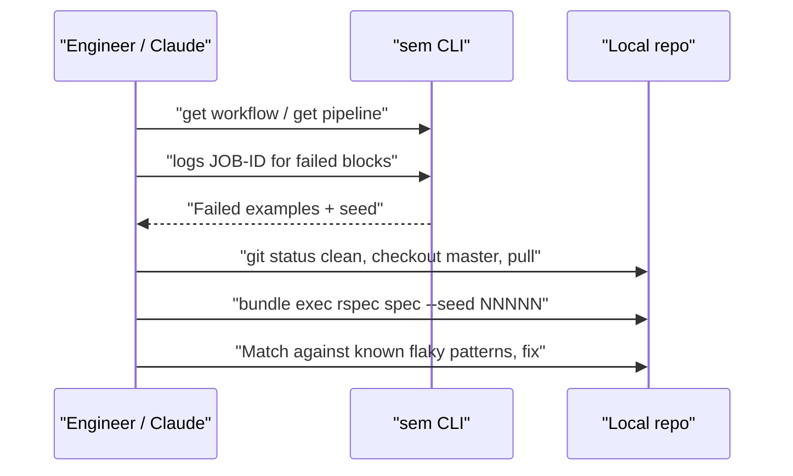

# Testing and local development

_Generated from rootlyhq/rootly at `5d980c6266a7` on 2026-11-03. A page goes stale when the files it cites change._

## Purpose and scope

This page covers how to run Rootly locally, how its RSpec suite is organised, which linters and ratchets guard the code, and the Claude Code helpers checked into the repo. It is a practical entry point for new engineers and for coding agents that are about to change code. Feature behaviour is documented on the domain pages; see [[Overview]] and [[Architecture]].

The main sources are:

| File | Role |
| --- | --- |
| `README.md` | Manual setup, Tilt pointer, 1Password, tunnel, Claude CLI and MCP |
| `AGENTS.md` / `CLAUDE.md` | Repo-wide rules for AI agents and humans: style, querying, API compatibility, testing |
| `.claude/agents/*.md`, `.claude/commands/*.md` | Sub-agent definitions and the flaky-test command |
| `lib/rubocop/cop/rootly/README.md` | Custom RuboCop cops |
| `.ratchet/README.md` | Baseline-driven CI ratchets |
| `bin/docker/README.md`, `bin/conductor.sh` | Worktree-isolated environments |
| `scripts/test-private-agent-acceptance.sh` | Cross-repo acceptance test for Private Connect agents |
| `.github/pull_request_template.md` | PR checklist |

## Local development setup

### Two paths: Tilt or manual

The recommended path is [rootlyhq/rootly-dev-env](https://github.com/rootlyhq/rootly/blob/5d980c6266a7994443a8136503d51de303298bcb/README.md#L20-L21). It is a Tilt-based setup that runs the monolith together with the notification system, the scheduler and the shared infrastructure: Postgres, Redis, DynamoDB, OpenSearch and Redpanda. The manual instructions in the README still assume that [infrastructure services come from rootly-dev-env](https://github.com/rootlyhq/rootly/blob/5d980c6266a7994443a8136503d51de303298bcb/README.md#L93).

The repo also contains a [`docker-compose.yml`](https://github.com/rootlyhq/rootly/blob/5d980c6266a7994443a8136503d51de303298bcb/docker-compose.yml#L1-L125) that defines these services:

- Postgres via `pgvector/pgvector:pg18`
- Redis 7.4
- OpenSearch 2.11.1
- Redpanda, plus its console and a Kafka Connect container
- ClickHouse, behind an opt-in `clickhouse` profile

```mermaid
flowchart TD
  "Clone repo" --> "brew install mise; mise install"
  "brew install mise; mise install" --> "brew bundle"
  "brew bundle" --> "Enable 1Password CLI integration"
  "Enable 1Password CLI integration" --> "rootctl tunnel setup"
  "rootctl tunnel setup" --> "Slack Dev app redirects + Slack Router"
  "Slack Dev app redirects + Slack Router" --> "bin/setup (fetches keys via op, bundle, yarn, DB)"
  "bin/setup (fetches keys via op, bundle, yarn, DB)" --> "bin/dev (rails, sidekiq, tunnel)"
  "bin/dev (rails, sidekiq, tunnel)" --> "Sign in with Slack at name.rootly.dev"
```

### Toolchain via mise

Ruby, Node and Yarn are managed by [mise](https://github.com/rootlyhq/rootly/blob/5d980c6266a7994443a8136503d51de303298bcb/README.md#L57-L82). You activate mise in your shell, then run `mise install` to install the versions in `.tool-versions`. The pinned versions are [Ruby 4.0.9, Node 24.22.1 and Yarn 1.22.19](https://github.com/rootlyhq/rootly/blob/5d980c6266a7994443a8136503d51de303298bcb/.tool-versions#L1-L3).

These pins must stay consistent in several places:

- The Gemfile declares [`ruby "4.0.9"` and `rails ~> 8.1`](https://github.com/rootlyhq/rootly/blob/5d980c6266a7994443a8136503d51de303298bcb/Gemfile#L7-L12).
- The Dockerfile notes that [RUBY_VERSION must match `.tool-versions` and the Gemfile](https://github.com/rootlyhq/rootly/blob/5d980c6266a7994443a8136503d51de303298bcb/Dockerfile#L4-L5).
- The Dockerfile installs Node through a [checksum-verified mise download](https://github.com/rootlyhq/rootly/blob/5d980c6266a7994443a8136503d51de303298bcb/Dockerfile#L33-L58).

If Ruby fails to build on macOS with a "missing psych" error, [install `libyaml`](https://github.com/rootlyhq/rootly/blob/5d980c6266a7994443a8136503d51de303298bcb/README.md#L80-L81).

### Credentials via 1Password

The 1Password CLI `op` is installed by `brew bundle`. It should be [integrated with the desktop app so it authenticates with biometrics](https://github.com/rootlyhq/rootly/blob/5d980c6266a7994443a8136503d51de303298bcb/README.md#L95-L105). `bin/setup` then [fetches the following through `op`](https://github.com/rootlyhq/rootly/blob/5d980c6266a7994443a8136503d51de303298bcb/README.md#L111):

- `development.key`
- `test.key`
- `TIPTAP_PRO_TOKEN`
- the Sidekiq Enterprise credentials

The tunnel setup also requires 1Password: `rootctl tunnel setup` gives each developer a [personal `https://{name}.rootly.dev` subdomain](https://github.com/rootlyhq/rootly/blob/5d980c6266a7994443a8136503d51de303298bcb/README.md#L163-L176).

### Slack wiring

To use Slack locally:

1. Become a collaborator on the Rootly Dev Slack app.
2. Add three OAuth redirect URLs for your rootly.dev domain.
3. Join the "Okay We Are Free" workspace.
4. Register with the Slack Router so webhooks reach your machine.

These steps are listed in the [README](https://github.com/rootlyhq/rootly/blob/5d980c6266a7994443a8136503d51de303298bcb/README.md#L113-L122). After you [sign in with Slack and add the Slack integration](https://github.com/rootlyhq/rootly/blob/5d980c6266a7994443a8136503d51de303298bcb/README.md#L155-L161), the `/rootly_dev` commands work. See [[Slack app]] for how the app itself works.

### Running the app

`bin/setup` [installs gems and JS packages and prepares the database](https://github.com/rootlyhq/rootly/blob/5d980c6266a7994443a8136503d51de303298bcb/README.md#L125-L128). `bin/dev` [starts Rails, Sidekiq and the Cloudflare tunnel](https://github.com/rootlyhq/rootly/blob/5d980c6266a7994443a8136503d51de303298bcb/README.md#L130-L134).

By default `bin/dev` runs many separate Sidekiq processes. Setting `SIDEKIQ_COMBINED=1` [merges all queues into one process using `config/sidekiq_combined.yml`](https://github.com/rootlyhq/rootly/blob/5d980c6266a7994443a8136503d51de303298bcb/README.md#L136-L146):

- **Benefit:** it saves several GB of memory.
- **Cost:** all queues share one log stream, so you lose `overmind connect <worker>` for a single worker.
- **CI guard:** `bin/check-sidekiq-combined` keeps the combined config in sync with the individual configs.

The first page load compiles stylesheets slowly. It may also open many browser tabs, which are [simulated email alerts](https://github.com/rootlyhq/rootly/blob/5d980c6266a7994443a8136503d51de303298bcb/README.md#L150-L151). See [[Background jobs and cron]] for the queue layout.

### Worktree-isolated environments (bin/docker, Conductor)

To run several worktrees in parallel, the `bin/docker/` scripts [run Postgres and Redis in Docker and Rails natively](https://github.com/rootlyhq/rootly/blob/5d980c6266a7994443a8136503d51de303298bcb/bin/docker/README.md#L1-L22).

How the isolation works:

- **Ports:** `bin/docker/ports` hashes the worktree directory name into an offset between 1 and 999. It adds that offset to a per-service base port, for example Postgres 15000+ and Redis 16000+, so [ports never collide](https://github.com/rootlyhq/rootly/blob/5d980c6266a7994443a8136503d51de303298bcb/bin/docker/README.md#L17).
- **Port table:** all [assigned ports are listed in the README](https://github.com/rootlyhq/rootly/blob/5d980c6266a7994443a8136503d51de303298bcb/bin/docker/README.md#L24-L35).
- **Database:** each worktree gets its own [`rootly_<worktree>_development` database](https://github.com/rootlyhq/rootly/blob/5d980c6266a7994443a8136503d51de303298bcb/bin/docker/README.md#L18).
- **Optional services:** OpenSearch and Kafka sit behind [Compose profiles](https://github.com/rootlyhq/rootly/blob/5d980c6266a7994443a8136503d51de303298bcb/bin/docker/README.md#L19-L22).

When the `CONDUCTOR_*` environment variables are present, the scripts use them. `.conductor/settings.toml` [maps Conductor's actions to the scripts](https://github.com/rootlyhq/rootly/blob/5d980c6266a7994443a8136503d51de303298bcb/bin/docker/README.md#L37-L44):

| Conductor action | Script |
| --- | --- |
| `setup` | `bin/docker/setup` |
| `run` | `bin/docker/run` |
| `archive` | `bin/docker/teardown` |

`bin/conductor.sh` is a small wrapper for Conductor worktrees:

1. It runs `mise trust` on any `mise.toml`, `.mise.toml` or `.tool-versions` it finds.
2. It activates mise for bash.
3. It runs `exec bin/setup` with the original arguments.

Without step 1, a fresh worktree would not pick up the right Ruby and Node versions ([source](https://github.com/rootlyhq/rootly/blob/5d980c6266a7994443a8136503d51de303298bcb/bin/conductor.sh#L1-L12)).

## Test conventions

### Stack and commands

Tests use [RSpec with FactoryBot and WebMock](https://github.com/rootlyhq/rootly/blob/5d980c6266a7994443a8136503d51de303298bcb/AGENTS.md#L5-L12). The test agent lists the [usual commands](https://github.com/rootlyhq/rootly/blob/5d980c6266a7994443a8136503d51de303298bcb/.claude/agents/test-agent.md#L14-L19):

- `bundle exec rspec` runs the whole suite.
- `bundle exec rspec <file>` runs one file.
- `bundle exec rspec -e '<pattern>'` runs examples matching a pattern.

Specs live in `spec/` and factories live in `spec/factories/` ([source](https://github.com/rootlyhq/rootly/blob/5d980c6266a7994443a8136503d51de303298bcb/.claude/agents/test-agent.md#L21-L27)).

The [expected coverage](https://github.com/rootlyhq/rootly/blob/5d980c6266a7994443a8136503d51de303298bcb/AGENTS.md#L99-L105) is:

| What | Cover |
| --- | --- |
| Services | Success and failure cases |
| Models | Validations, associations and methods |
| Components | Rendering, in the existing component specs |
| Controllers | Integration tests on critical paths |

Do not add standalone browser test scripts unless someone asks for them. The test agent also spells out the [patterns](https://github.com/rootlyhq/rootly/blob/5d980c6266a7994443a8136503d51de303298bcb/.claude/agents/test-agent.md#L29-L33):

- **Services:** call `described_class.new(...).call` and assert on the `Result` and its side effects.
- **ViewComponents:** use `render_inline` with `have_css` and similar matchers.

### `let_it_be` refinds by default

`spec/rails_helper.rb` configures `let_it_be` with `refind: true`. Each example therefore gets a fresh `Model.find(id)` instance. Because `use_transactional_fixtures` is on, database changes to these records [roll back after each example](https://github.com/rootlyhq/rootly/blob/5d980c6266a7994443a8136503d51de303298bcb/AGENTS.md#L107-L111).

Global side effects are not rolled back. Flipper's memory adapter is process-wide, so isolate flags with [the stub helpers instead of enabling flags directly](https://github.com/rootlyhq/rootly/blob/5d980c6266a7994443a8136503d51de303298bcb/AGENTS.md#L113-L114):

| Flag call site | Stub with |
| --- | --- |
| Legacy `Flipper` | `stub_flipper(...)` |
| `FeatureFlag.enabled?` / `FeatureFlag.variation` | `stub_feature_flag(...)` / `stub_feature_flag_variation(...)` from `spec/support/feature_flag_helpers.rb`. These program a LaunchDarkly `TestData` source and reset after each example. |

See [[Feature flags and configuration]].

### Query-shape tests

Code that narrows a `select` should get a SQL-capture spec using [`spec/support/sql_statement_capture.rb`](https://github.com/rootlyhq/rootly/blob/5d980c6266a7994443a8136503d51de303298bcb/AGENTS.md#L70-L77). This matters especially around wide columns such as `alerts.data`.

### Private Connect agent acceptance test

`scripts/test-private-agent-acceptance.sh` runs a test across the Rails app and the Go private agent. It works in five steps:

1. **Check inputs.** It requires `PRIVATE_AGENT_SOURCE` (the Go checkout), `KUBECONFIG` (a disposable Kind cluster) and `TEST_ENV_NUMBER`. It refuses to run unless `TEST_ENV_NUMBER` matches `private_agent_acceptance_*`, so the shared test database is never touched ([source](https://github.com/rootlyhq/rootly/blob/5d980c6266a7994443a8136503d51de303298bcb/scripts/test-private-agent-acceptance.sh#L1-L9)).
2. **Build the driver.** It compiles a race-enabled Go test binary with the `railsacceptance` tag into a temp directory, which is removed on exit ([source](https://github.com/rootlyhq/rootly/blob/5d980c6266a7994443a8136503d51de303298bcb/scripts/test-private-agent-acceptance.sh#L10-L22)).
3. **Start the Loki provider.** It runs the Go repo's `test-loki-provider.sh`.
4. **Start mixed providers.** Inside that, it runs `test-mixed-providers.sh`.
5. **Run the spec.** Inside both, it runs `spec/acceptance/private_agent_round_trip_spec.rb` ([source](https://github.com/rootlyhq/rootly/blob/5d980c6266a7994443a8136503d51de303298bcb/scripts/test-private-agent-acceptance.sh#L23-L26)).

See [[Integrations framework]] and [[AI platform]] for the surrounding features.

### Where exception-handling specs live

The `Rootly` module in `config/initializers/exceptions.rb` defines the app's shared exception types, built on `ExceptionReporter` / `capture_exception`. It is used by:

- the Slack and Microsoft Teams incoming-webhook models
- `Slack::V1::AuthenticatedController`

Its behaviour is covered by:

- `spec/initializers/exceptions_spec.rb`
- `spec/jobs/webhooks/incoming/webhook_processing_job_spec.rb`

## Investigating flaky tests

`CLAUDE.md` points Semaphore CI failures to [`.claude/commands/investigate-flaky-tests.md`](https://github.com/rootlyhq/rootly/blob/5d980c6266a7994443a8136503d51de303298bcb/CLAUDE.md#L35-L37). That command takes a Semaphore workflow URL and works through it:

1. **Find the failures.** It uses `sem get workflow` and `sem get pipeline`, downloads logs with `sem logs` into `/tmp/semaphore-build-logs-<ID>`, and strips ANSI codes ([source](https://github.com/rootlyhq/rootly/blob/5d980c6266a7994443a8136503d51de303298bcb/.claude/commands/investigate-flaky-tests.md#L7-L19)).
2. **Extract details.** It pulls out the failed examples and the `Randomized with seed` value ([source](https://github.com/rootlyhq/rootly/blob/5d980c6266a7994443a8136503d51de303298bcb/.claude/commands/investigate-flaky-tests.md#L20-L22)).
3. **Check the size.** It stops if there are more than 10 failures ([source](https://github.com/rootlyhq/rootly/blob/5d980c6266a7994443a8136503d51de303298bcb/.claude/commands/investigate-flaky-tests.md#L24-L27)).
4. **Reproduce.** It requires a clean tree, checks out `master`, and reruns with `--seed` ([source](https://github.com/rootlyhq/rootly/blob/5d980c6266a7994443a8136503d51de303298bcb/.claude/commands/investigate-flaky-tests.md#L29-L31)).



The command also catalogues the flaky patterns seen in this codebase ([source](https://github.com/rootlyhq/rootly/blob/5d980c6266a7994443a8136503d51de303298bcb/.claude/commands/investigate-flaky-tests.md#L33-L41)):

- stale `let_it_be` state, fixed with `.reload`, `reload: true` or `refind: true`
- a missing `Model.reindex` in `search: true` specs
- a missing `OpenSearch::AlertsIndex.create_schema!`
- Searchkick actions that query several indexes when the spec reindexes only one
- OpenSearch documents leaking between examples after `sidekiq: :inline`. In tests, `create_schema!` is turned into a `delete_by_query` by `OpenSearch::AlertsIndexSchemaReset`.
- `skip_callback` leaking globally

It also explains the "double clock read" flake in detail. A spec and the code under test each read `Time.current`, and on a loaded runner the two reads land on different sides of a threshold. The fix is `freeze_time`. The worked examples are the `ScheduleGapDetectorService` spec and the `distance_of_time_in_words` boundary in `spec/requests/slack/v1/incidents_help_spec.rb`. The command stresses fixing every builder that renders the shared trial section ([source](https://github.com/rootlyhq/rootly/blob/5d980c6266a7994443a8136503d51de303298bcb/.claude/commands/investigate-flaky-tests.md#L42-L46)). See [[Search indexing]].

## Linting

### RuboCop and custom cops

Run `bundle exec rubocop -a` before opening a PR ([source](https://github.com/rootlyhq/rootly/blob/5d980c6266a7994443a8136503d51de303298bcb/AGENTS.md#L91-L97)). Custom cops live in `lib/rubocop/cop/rootly/`:

| Cop | Enforces | Scope / autocorrect |
| --- | --- | --- |
| [`Rootly/RescueFromGenericExceptions`](https://github.com/rootlyhq/rootly/blob/5d980c6266a7994443a8136503d51de303298bcb/lib/rubocop/cop/rootly/README.md#L7-L57) | `rescue_from` on `StandardError`, `RuntimeError` or `Exception` must use `rescue_from_with_logging`, so the exception reaches request logs via `PayloadExtensions` | `app/controllers/**` |
| [`Rootly/FeatureFlagNaming`](https://github.com/rootlyhq/rootly/blob/5d980c6266a7994443a8136503d51de303298bcb/lib/rubocop/cop/rootly/README.md#L89-L122) | The flag name passed to `FeatureFlag.enabled?` / `variation` must be a kebab-case string literal, because it is the LaunchDarkly key | `app`, `lib`, `config`; no autocorrect |
| [`Rootly/NoStringColumnInMigration`](https://github.com/rootlyhq/rootly/blob/5d980c6266a7994443a8136503d51de303298bcb/lib/rubocop/cop/rootly/README.md#L124-L156) | Use `t.text`, not `t.string` | `db/migrate`; safe autocorrect |
| [`Rootly/ActiveJobGlobalId`](https://github.com/rootlyhq/rootly/blob/5d980c6266a7994443a8136503d51de303298bcb/lib/rubocop/cop/rootly/README.md#L158-L207) | No `_id` / `_ids` params and no `Model.find` inside `perform`; pass records via GlobalID. Sidekiq workers are exempt. | `app/jobs/**` |
| [`Rootly/NoSidekiqJobSetScan`](https://github.com/rootlyhq/rootly/blob/5d980c6266a7994443a8136503d51de303298bcb/lib/rubocop/cop/rootly/README.md#L209-L246) | No `find_job` and no set-level `delete` on `ScheduledSet` / `RetrySet` (incident INC-1682); use `ScheduledJobCancellation` | Everywhere except `spec/` |

[`.ratchet/README.md`](https://github.com/rootlyhq/rootly/blob/5d980c6266a7994443a8136503d51de303298bcb/.ratchet/README.md#L80-L83) also mentions a `Rootly/RaiseSpecificError` cop.

To add a cop ([source](https://github.com/rootlyhq/rootly/blob/5d980c6266a7994443a8136503d51de303298bcb/lib/rubocop/cop/rootly/README.md#L248-L256)):

1. Create the file in `lib/rubocop/cop/rootly/`.
2. Require it in `lib/rubocop/cop/rootly_cops.rb`.
3. Add specs under `spec/lib/rubocop/cop/rootly/`.
4. Document it in the cops README.

Existing offenders are usually baselined in `.rubocop_todo.yml`.

### Other linters

The lint agent's command list covers the [other linters](https://github.com/rootlyhq/rootly/blob/5d980c6266a7994443a8136503d51de303298bcb/.claude/agents/lint-agent.md#L13-L22):

- `yarn herb:lint` and `yarn herb:lint:changed:fix` for ERB templates
- `bundle exec brakeman` for security scanning

Pre-commit also runs the [design-system linters and `bin/lint-native-datetime-inputs`](https://github.com/rootlyhq/rootly/blob/5d980c6266a7994443a8136503d51de303298bcb/AGENTS.md#L36-L46). Fix what they report instead of bypassing the hook. See [[Design system and form components]] and [[Frontend]].

### Ratchets

`.ratchet/` holds baselines that may shrink but not grow. `bin/rails ratchet:check` and `bin/rails ratchet:baseline` [run or regenerate all rake-backed ratchets](https://github.com/rootlyhq/rootly/blob/5d980c6266a7994443a8136503d51de303298bcb/.ratchet/README.md#L1-L12). The [individual ratchets are listed in a table](https://github.com/rootlyhq/rootly/blob/5d980c6266a7994443a8136503d51de303298bcb/.ratchet/README.md#L14-L31). They cover:

- callbacks
- Flipper flags
- ActiveRecord Doctor
- unused routes
- sensitive DB fields
- Genius workflow errors
- Liquid team scope
- raw colours
- CI secret leaks, which you edit by hand
- spec-only bare AR attribute leaks and deprecations
- ArchSpec, regenerated with `bundle exec archspec check --update-todo`

Notable behaviours:

- **Sensitive-fields:** new entries are marked `REVIEW_REQUIRED` and block the check until someone fills them in ([source](https://github.com/rootlyhq/rootly/blob/5d980c6266a7994443a8136503d51de303298bcb/.ratchet/README.md#L40-L49)).
- **Liquid team scope:** this baseline catches `Api::Liquid::UserSerializer` renders without `team_id`, which can leak another team's Slack ID. It must stay empty ([source](https://github.com/rootlyhq/rootly/blob/5d980c6266a7994443a8136503d51de303298bcb/.ratchet/README.md#L51-L66)).
- **Raw-colours:** this baseline is keyed by path, so renaming a file requires regenerating it ([source](https://github.com/rootlyhq/rootly/blob/5d980c6266a7994443a8136503d51de303298bcb/.ratchet/README.md#L68-L71)).
- **Workflow-errors:** generic raises in `app/jobs/genius/tasks/` should become `Genius::Tasks::UserConfigurationError` or named exceptions ([source](https://github.com/rootlyhq/rootly/blob/5d980c6266a7994443a8136503d51de303298bcb/.ratchet/README.md#L73-L83)).

## Claude agents and commands

`CLAUDE.md` [imports `AGENTS.md`](https://github.com/rootlyhq/rootly/blob/5d980c6266a7994443a8136503d51de303298bcb/CLAUDE.md#L1-L9) and relies on the shared `rootly-agent-tools` plugin for `/fix-linear-issue` and `/fix-sentry-issue` ([source](https://github.com/rootlyhq/rootly/blob/5d980c6266a7994443a8136503d51de303298bcb/CLAUDE.md#L11-L29)). Claude's GitHub comments must be [prefixed with 🤖](https://github.com/rootlyhq/rootly/blob/5d980c6266a7994443a8136503d51de303298bcb/CLAUDE.md#L31-L33).

[`AGENTS.md`](https://github.com/rootlyhq/rootly/blob/5d980c6266a7994443a8136503d51de303298bcb/AGENTS.md#L16-L25) maps tasks to sub-agents: `@test-agent`, `@component-agent`, `@service-agent` and `@lint-agent`. Two of them are checked in:

- **`test-agent`** writes only to `spec/`. It must ask before adding gems or changing test configuration. It never edits `app/` and never deletes failing tests ([source](https://github.com/rootlyhq/rootly/blob/5d980c6266a7994443a8136503d51de303298bcb/.claude/agents/test-agent.md#L35-L38)).
- **`lint-agent`** only auto-fixes style and must not change logic. It commits formatting separately and asks before disabling rules ([source](https://github.com/rootlyhq/rootly/blob/5d980c6266a7994443a8136503d51de303298bcb/.claude/agents/lint-agent.md#L29-L40)).

AGENTS.md also sets these rules for all agents:

- **No code comments** ([source](https://github.com/rootlyhq/rootly/blob/5d980c6266a7994443a8136503d51de303298bcb/AGENTS.md#L48-L52)).
- **No defensive `&.`** on values that cannot be nil ([source](https://github.com/rootlyhq/rootly/blob/5d980c6266a7994443a8136503d51de303298bcb/AGENTS.md#L54-L68)).
- **Additive-only public API changes**, checked by the Semaphore "API Breaking Changes" block ([source](https://github.com/rootlyhq/rootly/blob/5d980c6266a7994443a8136503d51de303298bcb/AGENTS.md#L79-L84)).

The README describes the [Claude CLI plugin and MCP setup](https://github.com/rootlyhq/rootly/blob/5d980c6266a7994443a8136503d51de303298bcb/README.md#L178-L238) for Linear, Sentry, Notion, Rootly, Semaphore, Playwright, Figma and Pylon.

## Pull requests

Branches are named `feature/IR-1234-...`, commit messages follow conventional commits, and PR titles look like `[IR-1234] ...` ([source](https://github.com/rootlyhq/rootly/blob/5d980c6266a7994443a8136503d51de303298bcb/AGENTS.md#L86-L89)).

The PR template asks for these sections:

- Why
- What
- Demo
- Rollback plan
- A checklist: Linear link, risk label, reversibility and migrations, tests, access control, exception logging
- A deployment checklist covering staging and production validation receipts in Linear

([source](https://github.com/rootlyhq/rootly/blob/5d980c6266a7994443a8136503d51de303298bcb/.github/pull_request_template.md#L1-L41))

## Gotchas

- **Stale versions in AGENTS.md.** Its tech-stack list says [Rails 8.0 / Ruby 3.4.5](https://github.com/rootlyhq/rootly/blob/5d980c6266a7994443a8136503d51de303298bcb/AGENTS.md#L7), but `.tool-versions` and the Gemfile pin [Ruby 4.0.9](https://github.com/rootlyhq/rootly/blob/5d980c6266a7994443a8136503d51de303298bcb/.tool-versions#L1) and [Rails ~> 8.1](https://github.com/rootlyhq/rootly/blob/5d980c6266a7994443a8136503d51de303298bcb/Gemfile#L12). Trust the pins.
- **Two Yarn versions.** Locally `.tool-versions` pins Yarn 1.22.19, while the Docker build uses [Yarn 4.18.0 via corepack](https://github.com/rootlyhq/rootly/blob/5d980c6266a7994443a8136503d51de303298bcb/Dockerfile#L96-L99).
- **Do not disable Datadog with `DD_TRACE_ENABLED=false`.** That value still turns tracing on, because the check uses `.present?`. Use `DD_ENABLED=false` ([source](https://github.com/rootlyhq/rootly/blob/5d980c6266a7994443a8136503d51de303298bcb/Dockerfile#L139-L151)).
- **Feature-flag naming has no autocorrect.** `FeatureFlagNaming` will not autocorrect because renaming a flag changes its LaunchDarkly key.

## Related pages

[[Architecture]] · [[Feature flags and configuration]] · [[Background jobs and cron]] · [[Search indexing]] · [[Frontend]] · [[Design system and form components]] · [[Public REST API]] · [[Data migrations and backfills]] · [[Slack app]]

## Sources

- [.claude/agents/lint-agent.md:13-22](https://github.com/rootlyhq/rootly/blob/5d980c6266a7994443a8136503d51de303298bcb/.claude/agents/lint-agent.md#L13-L22)
- [.claude/agents/lint-agent.md:29-40](https://github.com/rootlyhq/rootly/blob/5d980c6266a7994443a8136503d51de303298bcb/.claude/agents/lint-agent.md#L29-L40)
- [.claude/agents/test-agent.md:14-19](https://github.com/rootlyhq/rootly/blob/5d980c6266a7994443a8136503d51de303298bcb/.claude/agents/test-agent.md#L14-L19)
- [.claude/agents/test-agent.md:21-27](https://github.com/rootlyhq/rootly/blob/5d980c6266a7994443a8136503d51de303298bcb/.claude/agents/test-agent.md#L21-L27)
- [.claude/agents/test-agent.md:29-33](https://github.com/rootlyhq/rootly/blob/5d980c6266a7994443a8136503d51de303298bcb/.claude/agents/test-agent.md#L29-L33)
- [.claude/agents/test-agent.md:35-38](https://github.com/rootlyhq/rootly/blob/5d980c6266a7994443a8136503d51de303298bcb/.claude/agents/test-agent.md#L35-L38)
- [.claude/commands/investigate-flaky-tests.md:7-22](https://github.com/rootlyhq/rootly/blob/5d980c6266a7994443a8136503d51de303298bcb/.claude/commands/investigate-flaky-tests.md#L7-L22)
- [.claude/commands/investigate-flaky-tests.md:24-27](https://github.com/rootlyhq/rootly/blob/5d980c6266a7994443a8136503d51de303298bcb/.claude/commands/investigate-flaky-tests.md#L24-L27)
- [.claude/commands/investigate-flaky-tests.md:29-31](https://github.com/rootlyhq/rootly/blob/5d980c6266a7994443a8136503d51de303298bcb/.claude/commands/investigate-flaky-tests.md#L29-L31)
- [.claude/commands/investigate-flaky-tests.md:33-46](https://github.com/rootlyhq/rootly/blob/5d980c6266a7994443a8136503d51de303298bcb/.claude/commands/investigate-flaky-tests.md#L33-L46)
- [.github/pull_request_template.md:1-41](https://github.com/rootlyhq/rootly/blob/5d980c6266a7994443a8136503d51de303298bcb/.github/pull_request_template.md#L1-L41)
- [.ratchet/README.md:1-12](https://github.com/rootlyhq/rootly/blob/5d980c6266a7994443a8136503d51de303298bcb/.ratchet/README.md#L1-L12)
- [.ratchet/README.md:14-31](https://github.com/rootlyhq/rootly/blob/5d980c6266a7994443a8136503d51de303298bcb/.ratchet/README.md#L14-L31)
- [.ratchet/README.md:40-49](https://github.com/rootlyhq/rootly/blob/5d980c6266a7994443a8136503d51de303298bcb/.ratchet/README.md#L40-L49)
- [.ratchet/README.md:51-66](https://github.com/rootlyhq/rootly/blob/5d980c6266a7994443a8136503d51de303298bcb/.ratchet/README.md#L51-L66)
- [.ratchet/README.md:68-71](https://github.com/rootlyhq/rootly/blob/5d980c6266a7994443a8136503d51de303298bcb/.ratchet/README.md#L68-L71)
- [.ratchet/README.md:73-83](https://github.com/rootlyhq/rootly/blob/5d980c6266a7994443a8136503d51de303298bcb/.ratchet/README.md#L73-L83)
- [.tool-versions:1-3](https://github.com/rootlyhq/rootly/blob/5d980c6266a7994443a8136503d51de303298bcb/.tool-versions#L1-L3)
- [AGENTS.md:5-12](https://github.com/rootlyhq/rootly/blob/5d980c6266a7994443a8136503d51de303298bcb/AGENTS.md#L5-L12)
- [AGENTS.md:16-25](https://github.com/rootlyhq/rootly/blob/5d980c6266a7994443a8136503d51de303298bcb/AGENTS.md#L16-L25)
- [AGENTS.md:36-46](https://github.com/rootlyhq/rootly/blob/5d980c6266a7994443a8136503d51de303298bcb/AGENTS.md#L36-L46)
- [AGENTS.md:48-52](https://github.com/rootlyhq/rootly/blob/5d980c6266a7994443a8136503d51de303298bcb/AGENTS.md#L48-L52)
- [AGENTS.md:54-68](https://github.com/rootlyhq/rootly/blob/5d980c6266a7994443a8136503d51de303298bcb/AGENTS.md#L54-L68)
- [AGENTS.md:70-77](https://github.com/rootlyhq/rootly/blob/5d980c6266a7994443a8136503d51de303298bcb/AGENTS.md#L70-L77)
- [AGENTS.md:79-84](https://github.com/rootlyhq/rootly/blob/5d980c6266a7994443a8136503d51de303298bcb/AGENTS.md#L79-L84)
- [AGENTS.md:86-89](https://github.com/rootlyhq/rootly/blob/5d980c6266a7994443a8136503d51de303298bcb/AGENTS.md#L86-L89)
- [AGENTS.md:91-97](https://github.com/rootlyhq/rootly/blob/5d980c6266a7994443a8136503d51de303298bcb/AGENTS.md#L91-L97)
- [AGENTS.md:99-105](https://github.com/rootlyhq/rootly/blob/5d980c6266a7994443a8136503d51de303298bcb/AGENTS.md#L99-L105)
- [AGENTS.md:107-111](https://github.com/rootlyhq/rootly/blob/5d980c6266a7994443a8136503d51de303298bcb/AGENTS.md#L107-L111)
- [AGENTS.md:113-114](https://github.com/rootlyhq/rootly/blob/5d980c6266a7994443a8136503d51de303298bcb/AGENTS.md#L113-L114)
- [bin/conductor.sh:1-12](https://github.com/rootlyhq/rootly/blob/5d980c6266a7994443a8136503d51de303298bcb/bin/conductor.sh#L1-L12)
- [bin/docker/README.md:1-22](https://github.com/rootlyhq/rootly/blob/5d980c6266a7994443a8136503d51de303298bcb/bin/docker/README.md#L1-L22)
- [bin/docker/README.md:24-35](https://github.com/rootlyhq/rootly/blob/5d980c6266a7994443a8136503d51de303298bcb/bin/docker/README.md#L24-L35)
- [bin/docker/README.md:37-44](https://github.com/rootlyhq/rootly/blob/5d980c6266a7994443a8136503d51de303298bcb/bin/docker/README.md#L37-L44)
- [CLAUDE.md:1-9](https://github.com/rootlyhq/rootly/blob/5d980c6266a7994443a8136503d51de303298bcb/CLAUDE.md#L1-L9)
- [CLAUDE.md:11-29](https://github.com/rootlyhq/rootly/blob/5d980c6266a7994443a8136503d51de303298bcb/CLAUDE.md#L11-L29)
- [CLAUDE.md:31-33](https://github.com/rootlyhq/rootly/blob/5d980c6266a7994443a8136503d51de303298bcb/CLAUDE.md#L31-L33)
- [CLAUDE.md:35-37](https://github.com/rootlyhq/rootly/blob/5d980c6266a7994443a8136503d51de303298bcb/CLAUDE.md#L35-L37)
- [docker-compose.yml:1-125](https://github.com/rootlyhq/rootly/blob/5d980c6266a7994443a8136503d51de303298bcb/docker-compose.yml#L1-L125)
- [Dockerfile:4-5](https://github.com/rootlyhq/rootly/blob/5d980c6266a7994443a8136503d51de303298bcb/Dockerfile#L4-L5)
- [Dockerfile:33-58](https://github.com/rootlyhq/rootly/blob/5d980c6266a7994443a8136503d51de303298bcb/Dockerfile#L33-L58)
- [Dockerfile:96-99](https://github.com/rootlyhq/rootly/blob/5d980c6266a7994443a8136503d51de303298bcb/Dockerfile#L96-L99)
- [Dockerfile:139-151](https://github.com/rootlyhq/rootly/blob/5d980c6266a7994443a8136503d51de303298bcb/Dockerfile#L139-L151)
- [Gemfile:7-12](https://github.com/rootlyhq/rootly/blob/5d980c6266a7994443a8136503d51de303298bcb/Gemfile#L7-L12)
- [lib/rubocop/cop/rootly/README.md:7-57](https://github.com/rootlyhq/rootly/blob/5d980c6266a7994443a8136503d51de303298bcb/lib/rubocop/cop/rootly/README.md#L7-L57)
- [lib/rubocop/cop/rootly/README.md:89-122](https://github.com/rootlyhq/rootly/blob/5d980c6266a7994443a8136503d51de303298bcb/lib/rubocop/cop/rootly/README.md#L89-L122)
- [lib/rubocop/cop/rootly/README.md:124-156](https://github.com/rootlyhq/rootly/blob/5d980c6266a7994443a8136503d51de303298bcb/lib/rubocop/cop/rootly/README.md#L124-L156)
- [lib/rubocop/cop/rootly/README.md:158-207](https://github.com/rootlyhq/rootly/blob/5d980c6266a7994443a8136503d51de303298bcb/lib/rubocop/cop/rootly/README.md#L158-L207)
- [lib/rubocop/cop/rootly/README.md:209-246](https://github.com/rootlyhq/rootly/blob/5d980c6266a7994443a8136503d51de303298bcb/lib/rubocop/cop/rootly/README.md#L209-L246)
- [lib/rubocop/cop/rootly/README.md:248-256](https://github.com/rootlyhq/rootly/blob/5d980c6266a7994443a8136503d51de303298bcb/lib/rubocop/cop/rootly/README.md#L248-L256)
- [README.md:20-21](https://github.com/rootlyhq/rootly/blob/5d980c6266a7994443a8136503d51de303298bcb/README.md#L20-L21)
- [README.md:57-82](https://github.com/rootlyhq/rootly/blob/5d980c6266a7994443a8136503d51de303298bcb/README.md#L57-L82)
- [README.md:93-93](https://github.com/rootlyhq/rootly/blob/5d980c6266a7994443a8136503d51de303298bcb/README.md#L93)
- [README.md:95-105](https://github.com/rootlyhq/rootly/blob/5d980c6266a7994443a8136503d51de303298bcb/README.md#L95-L105)
- [README.md:111-111](https://github.com/rootlyhq/rootly/blob/5d980c6266a7994443a8136503d51de303298bcb/README.md#L111)
- [README.md:113-122](https://github.com/rootlyhq/rootly/blob/5d980c6266a7994443a8136503d51de303298bcb/README.md#L113-L122)
- [README.md:125-128](https://github.com/rootlyhq/rootly/blob/5d980c6266a7994443a8136503d51de303298bcb/README.md#L125-L128)
- [README.md:130-134](https://github.com/rootlyhq/rootly/blob/5d980c6266a7994443a8136503d51de303298bcb/README.md#L130-L134)
- [README.md:136-146](https://github.com/rootlyhq/rootly/blob/5d980c6266a7994443a8136503d51de303298bcb/README.md#L136-L146)
- [README.md:150-151](https://github.com/rootlyhq/rootly/blob/5d980c6266a7994443a8136503d51de303298bcb/README.md#L150-L151)
- [README.md:155-161](https://github.com/rootlyhq/rootly/blob/5d980c6266a7994443a8136503d51de303298bcb/README.md#L155-L161)
- [README.md:163-176](https://github.com/rootlyhq/rootly/blob/5d980c6266a7994443a8136503d51de303298bcb/README.md#L163-L176)
- [README.md:178-238](https://github.com/rootlyhq/rootly/blob/5d980c6266a7994443a8136503d51de303298bcb/README.md#L178-L238)
- [scripts/test-private-agent-acceptance.sh:1-26](https://github.com/rootlyhq/rootly/blob/5d980c6266a7994443a8136503d51de303298bcb/scripts/test-private-agent-acceptance.sh#L1-L26)
